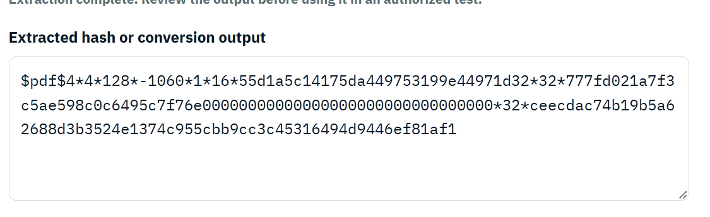
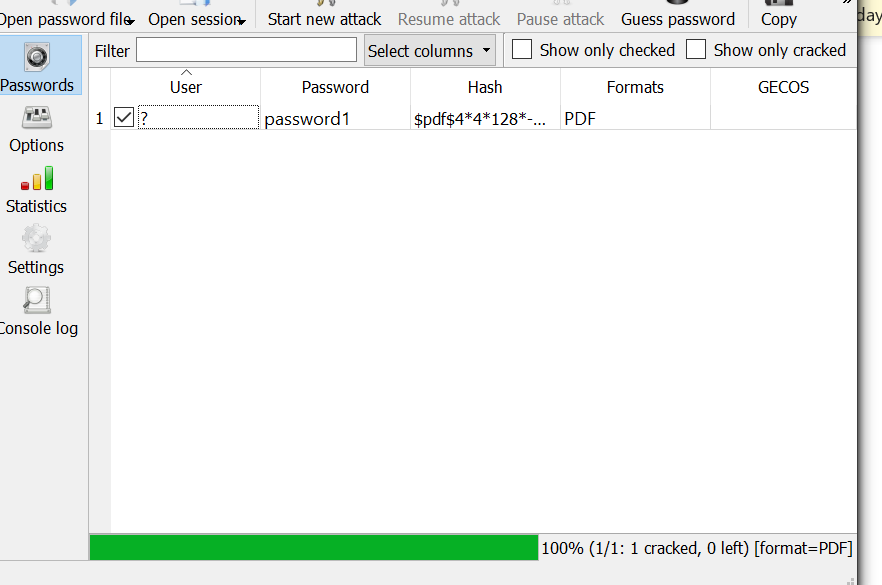
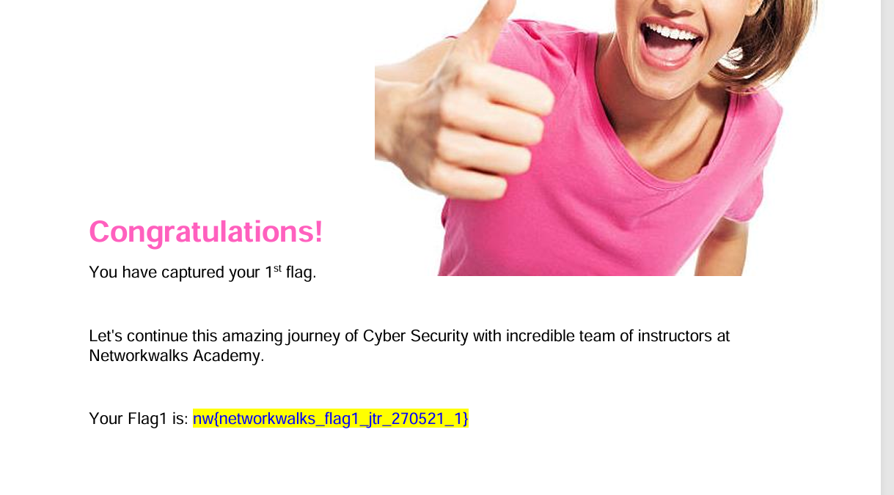
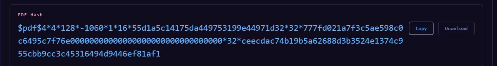
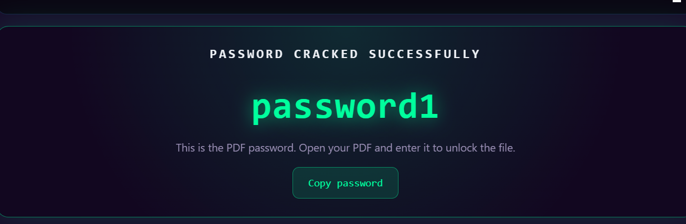

# Password Cracking Report
John the Ripper & Networkwalks Tools | Week 3

| Field | Detail |
|---|---|
| Pentester | Princewill John Eze |
| Program/Batch | B084 - Networkwalks |
| Date | [FILL IN] |
| Modules completed | W3-PM1, W3-PM2 |
| Target / Test file | My Locked PDF1.pdf (instructor-provided test file, no live system touched) |

## 1. Liability Disclaimer
I carried out every activity in this report only on the test file provided by the instructor for this lab, or on systems I own. This is for education and research only.

## 2. Introduction
This covers Week 3 of the Networkwalks Cybersecurity Internship. Both modules focus on password cracking: recovering the password of a protected PDF by extracting its hash and running a cracking tool against it. W3-PM1 used John the Ripper with its Johnny GUI on my Windows laptop. W3-PM2 repeated the exercise using Networkwalks' own browser tools, the Hash Calculator and Password Cracker. Both ran against the same test file, My Locked PDF1.pdf, supplied by the instructor.

## 3. Tools Used
| Tool | Purpose |
|---|---|
| John the Ripper (JTR) | Password cracking engine that tries many passwords against a hash |
| Johnny | Graphical front end for John the Ripper |
| Online PDF Hash Extractor | Reads a protected PDF and extracts its password hash |
| Networkwalks Hash Calculator | Browser tool that extracts the password hash from a protected PDF |
| Networkwalks Password Cracker | Browser tool that tries passwords against a hash until it finds a match |

## 4. Activities Performed

### 4.1 Password Cracking with John the Ripper (W3-PM1)
- Installed Johnny and pointed it to `john.exe` so it could use John the Ripper's engine.
- Uploaded the locked PDF to an online hash extractor, which returned a hash starting with `$pdf$`.
- Saved the hash into `hash1.txt` and opened it in Johnny.
- Started the attack. Johnny recovered the password: **password1**.
- Time taken: [FILL IN]
- Confirmed by opening the PDF with the recovered password: [FILL IN: yes, it opened]

### 4.2 Password Cracking with Networkwalks Tools (W3-PM2)
- Uploaded the same PDF to the Networkwalks Hash Calculator, which returned the same `$pdf$` hash.
- Pasted the hash into the Networkwalks Password Cracker and started the attack.
- The tool recovered the identical password: **password1**.
- Time taken: [FILL IN]

Both tools recovered the same password from the same file, which shows the weakness is in the password itself, not in either tool.

## 5. Risk Analysis
| # | Finding | Evidence | Possible impact | Level |
|---|---|---|---|---|
| 1 | Weak password protects the test file | Both tools cracked `password1` in [FILL IN: time] | A weak password can be cracked almost immediately, regardless of the tool used | Medium |
| 2 | Password uses a common word plus a single digit | Recovered password follows a well-known weak pattern | Such patterns are among the first guesses any cracking tool tries | Medium |

These are observations from a training exercise on a supplied test file. No live or third-party system was accessed.

## 6. Recommendations
- **Use long, random passwords.** 12+ characters, mixed types, resist cracking far longer than short or common ones.
- **Avoid dictionary word + number patterns.** These are guessed first by any cracking tool.
- **Use a password manager** to make long, unique passwords practical.
- **Treat file-level passwords as seriously as account passwords.**

## 7. Conclusion
Both tools followed the same process: extract the password's hash, then try candidate passwords against it until one matches. Both recovered the identical password, `password1`, showing that a weak, predictable password is cracked quickly no matter which tool is used. This exercise showed why password strength matters more than the specific cracking tool an attacker might choose.
